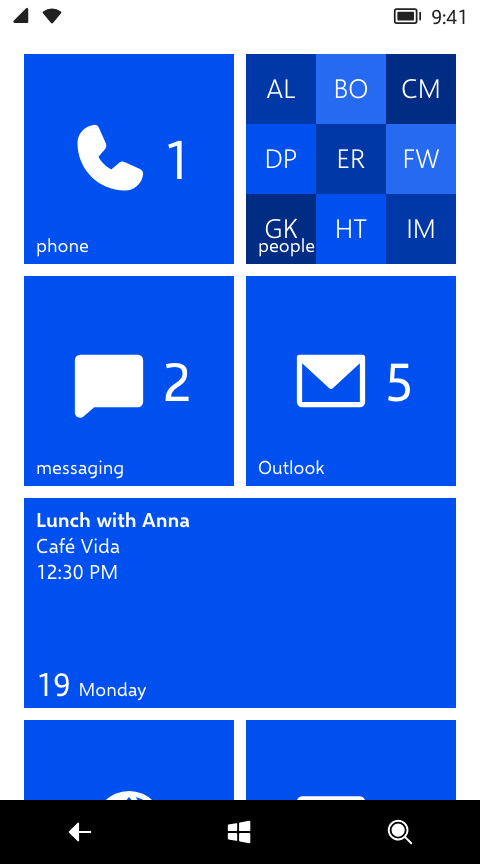

# metroweb

Windows Phone 8 in the browser, and the library it is built on, for making apps that look and move like the phone. The phone has Start and its live tiles, the app list, Settings and ten other apps, rebuilt with React 19 and TypeScript and no UI libraries. Every colour, size and curve says where it came from: the phone's own theme files and markup, the Windows Phone Toolkit, frame-by-frame measurements of real phones or, failing those, a match by eye.

**Live:** [wp8.vercel.app](https://wp8.vercel.app) · **Design system:** [wp8.vercel.app/design](https://wp8.vercel.app/design)

<p>
  
  
  
  
</p>

## What's here

- **The phone** ([`apps/web/`](apps/web)): Start with live tiles, the app list, the system tray and volume band, Settings, and Alarms, Calculator, Calendar, Camera, Messaging, Music+Videos, OneNote, People, Phone and Photos. Light and dark themes and all 20 accents. Pages turn with the turnstile, feather and continuum transitions, and anything you press tilts.
- **The library** ([`packages/metroweb/`](packages/metroweb/README.md)): the `metroweb` package the phone is built on. The pivot and panorama, lists, toggle switches, pickers, text boxes, the app bar and message boxes; the page stack and its transitions; tilt; the type ramp, both themes and the 20 accents.
- **The starter** ([`templates/starter/`](templates/starter/README.md)): a small to-do app on the package, to copy when you start your own.
- **The design system** ([`docs/design/`](docs/design/README.md)): 14 pages on how Metro looks, moves and behaves, from the 480 px canvas and the 12 px grid to motion, navigation, components, live tiles and writing. Each value gives its Microsoft name, the CSS variable that holds it and a [source label](docs/design/README.md#source-labels) that says how far to trust it. The same pages are a site with live demos at [/design](https://wp8.vercel.app/design).
- **The evidence tools** ([`docs/evidence/`](docs/evidence/README.md)): the decoders for the emulator image's UIX markup and string tables, the Swift tools that measured footage of real phones, and the curve fits. The Microsoft files and video frames they produced are kept out of this repository.

## Build a Metro app

Copy the starter:

```sh
npx degit ImperialBebek/metroweb/templates/starter my-app
cd my-app
npm install
npm run dev
```

Or add the package to an app you already have:

```sh
npm install metroweb
```

The [package README](packages/metroweb/README.md) has a quick start, the components and the short version of the rules that keep an app looking and behaving like the phone. The [design docs](https://wp8.vercel.app/design) are the full spec.

## Run the phone

Needs Node 20.19+ or 22.12+. The repository is an npm workspace, so run everything from its root.

```sh
npm install
npm run dev     # the phone at /, the design docs at /design
npm run lint    # oxlint
npm run build   # type check and build the package, the phone and the starter
```

`npm run docs:assets` regenerates the screenshots, diagrams and motion strips in `docs/design/assets`. It needs a Playwright Chromium (`npx playwright-core install chromium-headless-shell`) or `CHROMIUM_PATH` pointing at one.

## Contributing

Read [`AGENTS.md`](AGENTS.md), which is for people as much as for agents, and the [design docs](docs/design/README.md) page for the area you're changing. In short: the phone wins over web conventions, every value carries a source label, and the docs change in the same commit as the code.

## Credits and licences

- The code and docs are under the [MIT License](LICENSE).
- Text is set in Metroweb Sans: [Selawik](https://github.com/microsoft/Selawik), Microsoft's open-source metric match for Segoe UI, modified and renamed as its licence requires. It is under the [SIL Open Font License](packages/metroweb/fonts/SELAWIK-LICENSE.txt).
- Icons are from [Phosphor](https://phosphoricons.com), under the [MIT License](packages/metroweb/src/icons/LICENSE-phosphor.txt).
- Tilt is a port of the Windows Phone Toolkit's `TiltEffect`, and values labelled **Toolkit** come from the Toolkit's source (Microsoft Public License).
- The music is public-domain recordings from Wikimedia Commons; see [`apps/web/public/music/CREDITS.md`](apps/web/public/music/CREDITS.md).
- The sample photos in `apps/web/public/photos/` are AI-generated for this project.

[`THIRD-PARTY-NOTICES.md`](THIRD-PARTY-NOTICES.md) has the details.

## Disclaimer

metroweb is an independent fan project. It is not affiliated with, endorsed by or sponsored by Microsoft. Windows and Windows Phone are trademarks of the Microsoft group of companies. None of the phone's own fonts, icons, sounds or images ship in this repository.
