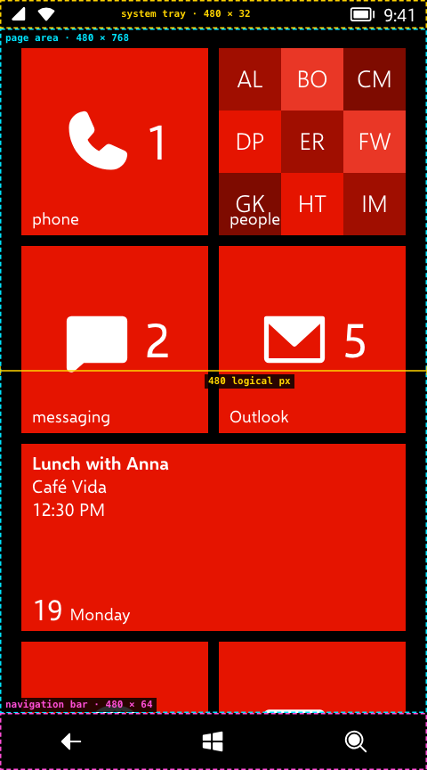

# 02 · Canvas

> **Status** Draft · **Baseline** 8.0 screen, 8.1 navigation bar · **Last reviewed** 2026-10-19
> **Code** [`src/App.tsx`](../../src/App.tsx) (`useViewport`, `safeInsets`), [`src/index.css`](../../src/index.css) (`.desk`, `.screen`, `.page-stack`, `.popup-layer`)
> **Sources** Windows Phone 8 logical resolution; emulator screenshots

## The logical screen

Windows Phone 8 lays every app out at a logical width of **480 px** and scales it to the panel (WVGA 480 × 800, WXGA 768 × 1280, 720p and 1080p). The recreation does the same: the whole screen is a 480 px wide element, scaled down with `transform: scale()` on viewports narrower than 480 px.

- **Width** is always 480 logical px.
- **Height** follows the viewport: the visible height, less any safe-area insets, divided by the scale.
- On wider viewports the screen sits in a centred column on the "desk", which is painted in the theme background.

*Measured from the running app at a 480 × 864 viewport, which gives a WVGA-sized 768 px page area.*

## Regions

| Region | Size | Variable | Source |
|---|---|---|---|
| System tray | 480 × 32 | `--tray-height` (0 in a home-screen web app) | Estimated, matches emulator screenshots |
| Page area | 480 × the rest | `.page-stack`, `.start`, `.popup-layer` all use `inset: var(--tray-height) 0 var(--nav-height)` | — |
| Navigation bar | 480 × 64 | `--nav-height` | Estimated, from WP8.1 footage |

The page area is the only space apps draw in. The tray and navigation bar belong to the system ([System UI](11-system-ui.md)).

## Stacking order

| Layer | `z-index` | Notes |
|---|---|---|
| Start and app pages | auto | Start is hidden (not unmounted) while an app runs. |
| Popup layer | 2 | Full-screen pickers and message boxes portal here, over the current page. |
| System tray | 3 | |
| Navigation bar | 4 | |
| Volume band | 6 | Drops over everything, including the tray. |
| Desk controls | 10 | Motion speed dial and volume keys, outside the screen. |

## Scaling, viewport height and safe areas

- `useViewport()` recomputes on `resize` and `visualViewport` resize.
- The visible height is `max(innerHeight, documentElement.clientHeight)`. iOS home-screen apps can report a short `innerHeight`, so the larger of the two wins.
- `.desk` is `position: fixed` at the top with an explicit height, so the browser can't scroll the page under the screen.
- Safe-area insets (`env(safe-area-inset-top/bottom)`) are measured once per resize with a hidden probe element. The screen is pushed down by the top inset and shortened by both. Black strips fill the insets, extending the navigation bar at the bottom.
- `index.html` asks iOS for an opaque `black` status bar. With `black-translucent`, iOS made the page a status bar shorter than the display and left a band the page couldn't draw into.

### Home-screen web apps

When launched from the home screen (`display-mode: standalone` or `navigator.standalone`), the device's own status bar is always visible, so the phone's system tray is left out and `--tray-height` becomes `0px`. Tapping the top safe-area strip stands in for tapping the tray.

## Rules

- Lay out in logical px at 480 wide. Never use viewport units inside the screen.
- Apps get the page area only. Do not position anything under the tray or navigation bar.
- Use `overflow: clip`, not `hidden`, on the screen and anything that holds perspective transforms. `hidden` lets focus or `scrollIntoView` scroll the screen itself.
