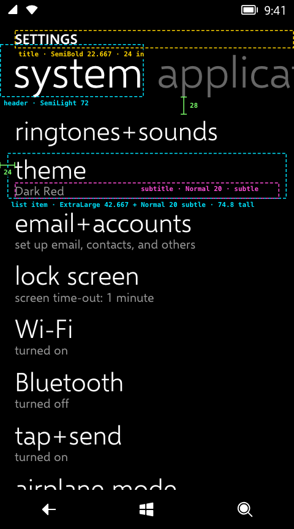
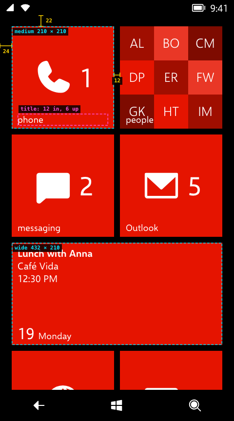
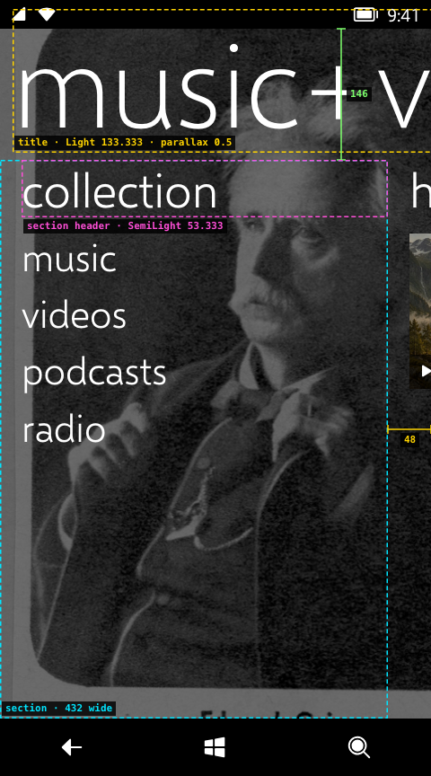
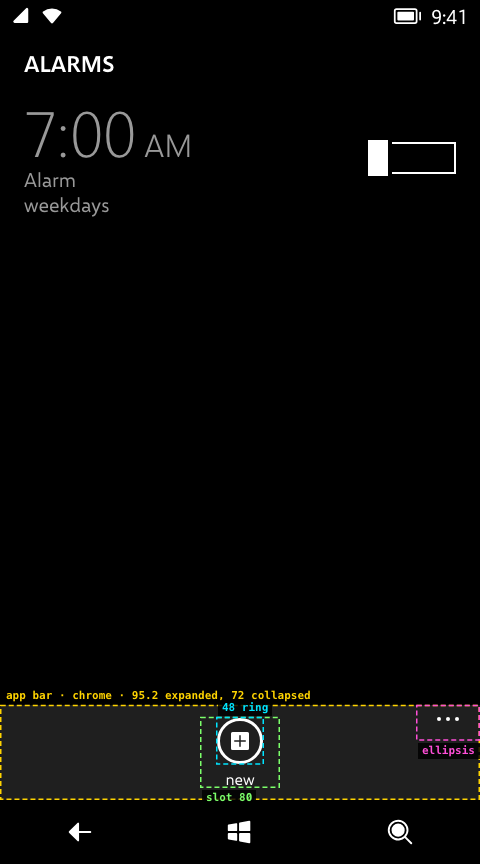

# 03 · Layout

> **Status** Draft · **Baseline** 8.0 · **Last reviewed** 2026-10-19
> **Code** [`src/index.css`](../../src/index.css), [`src/components/panorama.css`](../../src/components/panorama.css), [`src/components/AppBar.tsx`](../../src/components/AppBar.tsx)
> **Sources** `0100_ThemeResources.xaml` and `System.Windows.xaml` (copied to [`docs/evidence/theme`](../evidence/theme)); emulator screenshots

## The 12 px grid

Windows Phone spaces everything in multiples of 12 logical px. Text starts **24 px** from the screen's left edge almost everywhere: a 12 px page margin plus a 12 px item margin.

| Microsoft name | Value | In the recreation | Source |
|---|---|---|---|
| `PhoneMargin` | 12 | `--wp-margin`: the side margin of text blocks (paragraphs, headers above controls, toggle rows, message box text, panorama sections) | Decoded |
| `PhoneHorizontalMargin` | 12, 0 | `--wp-margin` on each side (`.paragraph`, `.toggle-row`) | Decoded |
| `PhoneVerticalMargin` | 0, 12 | `--wp-margin` above and below; not used yet | Decoded |
| `PhoneTouchTargetOverhang` | 12 | `--wp-touch-target-overhang`: the margin around touch targets (list items, buttons, list picker and date boxes, message box buttons) | Decoded |
| `PhoneTouchTargetLargeOverhang` | 12, 20 | not used yet | Decoded |
| `PivotItemMargin` | 12, 28, 12, 0 | `.pivot-item { inset: 28px 12px 0 }` | Decoded |
| `PhoneBorderThickness` | 3 | `--wp-border-thickness`: every 3 px border (buttons, message boxes, text boxes, check boxes, the looping selector) | Decoded |
| `PhoneStrokeThickness` | 3 | `--wp-stroke-thickness`: the ring on app bar buttons, the Start arrow, app list search and the Messaging contact button, and the Camera buttons and shutter | Decoded |
| `PhoneTextBoxInnerMargin` | 1, 2 | `--wp-text-box-inner-margin`; not used yet, text boxes use `0 9px` padding | Decoded |

The variables live in `:root` in `src/index.css`. Use one when a value means that resource. A 12 px that is its own measurement (the gap between tiles, the tile title inset) stays a literal.

## Pages

| Element | Value | Source |
|---|---|---|
| Pivot title | 17 px from the top of the page area, 24 px from the left | Estimated |
| Pivot headers | 21 px left padding, so the 72 px glyphs' side bearing lines up near 24 px | Estimated |
| Pivot item | 28 px below the headers, 12 px side margins | Decoded (`PivotItemMargin`) |
| List item | 12 px side padding, 12 px between items | Decoded (`PhoneTouchTargetOverhang`) |
| Paragraph | 12 px sides, 24 px below | Estimated |
| Toggle row | 72 px tall | Estimated |
| List picker | 24 px below, 44 px rows | Estimated |
| End of a scrolling page | 36 px bottom padding | Estimated |

## Start

| Element | Value | Source |
|---|---|---|
| Pane | 480 wide, padding 22 top, 24 sides, 48 bottom | Estimated |
| Grid | 4 columns of 99 px cells, 12 px gaps | Estimated, matches Microsoft's published WXGA tile sizes (159, 336, 691 px) scaled by 0.625 |
| Small tile | 99 × 99 (1 × 1 cell) | as above |
| Medium tile | 210 × 210 (2 × 2) | as above |
| Wide tile | 432 × 210 (4 × 2) | as above |
| Tile title | 12 px from the left, 6 px from the bottom | Estimated |
| App list icon | 62 × 62 accent square, 12 px gap to the title | Estimated; `StartAssets480x800` holds a 62, 62 constant (Decoded, unattributed) |

See [Start and live tiles](10-start-and-live-tiles.md) for the layout itself.

## Panorama

| Element | Value | Source |
|---|---|---|
| Section | 432 px wide, so the next section's header peeks in 48 px | Estimated |
| Section top | 146 px below the top of the page area | Estimated |
| Title | Light 133.333 px, 14 px from the left, 22 px above the top | Estimated |
| Section header | 12 px in, 18 px above the content | Estimated |
| Parallax | title moves 0.5 × its width across all sections; background moves 160 px | Estimated |

## App bar

| Element | Value | Source |
|---|---|---|
| Height | 72 collapsed, 30 minimized; grows upward when expanded | Estimated |
| Buttons | up to four, each an 80 px slot with a 48 px ring, centred, 12 px top and bottom padding, 64 px side padding | Estimated |
| Ellipsis | 64 × 36 target in the top-right corner, three 4 px dots 5 px apart | Estimated |
| Menu items | 9 px × 24 px padding, MediumLarge text | Estimated |

## Gestures

| Value | Where | Source |
|---|---|---|
| 12 px | Tap slop: a press that moves further becomes a pan and the tilt releases | Estimated |
| 14 px | Axis lock for pivot, panorama and Start pans | Estimated |
| 25% / 20% of the width | Pivot / panorama commit distance | Estimated |
| 120 px | Start pane commit distance | Estimated |
| 0.45 px/ms | Flick velocity that commits a pan regardless of distance | Estimated |
