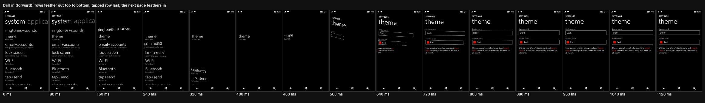
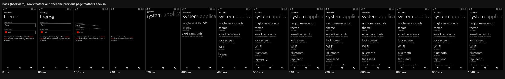
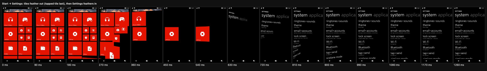
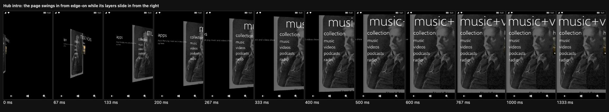
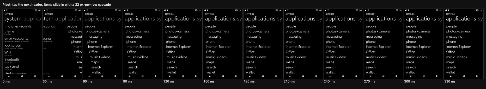

# 07 · Motion

> **Status** Draft · **Baseline** 8.0, with 8.1 footage where noted · **Last reviewed** 2026-10-26
> **Code** [`packages/metroweb/src/motion.ts`](../../packages/metroweb/src/motion.ts), [`packages/metroweb/src/pageMotion.ts`](../../packages/metroweb/src/pageMotion.ts), [`packages/metroweb/src/navigation.tsx`](../../packages/metroweb/src/navigation.tsx), [`apps/web/src/start/StartScreen.tsx`](../../apps/web/src/start/StartScreen.tsx), [`apps/web/src/start/tileFlip.ts`](../../apps/web/src/start/tileFlip.ts), [`packages/metroweb/src/components/useTilt.ts`](../../packages/metroweb/src/components/useTilt.ts), [`packages/metroweb/src/motionSpeed.ts`](../../packages/metroweb/src/motionSpeed.ts)
> **Sources** Windows Phone Toolkit (`TurnstileTransition`, `SwivelTransition`, `TiltEffect`); UIX markup in `ShellControls.dll` and `UIXMobileAssets480x800.dll`; footage (see [evidence](../evidence/footage/README.md))

Motion in Metro is how you know where you are. Pages swing on a hinge at the left edge of the screen; content leaves in reading order; the thing you tapped leaves last and lands in the next page's title. Nothing bounces, and nothing fades without also moving.

## Easing

The Toolkit storyboards use Silverlight's `ExponentialEase`. `motion.ts` samples it into a CSS `linear()` easing with 33 points, so Web Animations and CSS transitions play the same curve.

| Name | Curve | Used for | Source |
|---|---|---|---|
| `EXPO_OUT_6` | `ExponentialEase` Exponent 6, EaseOut | Toolkit arrivals: pages, popups, app bar, pivot snap | Toolkit |
| `EXPO_IN_6` | Exponent 6, EaseIn | Toolkit departures, continuum hide | Toolkit |
| `EXPO_OUT_5` | Exponent 5, EaseOut | Native turnstile arrivals (`Log` weight 150, $\ln 150 \approx 5.01$), hub layer slide | Decoded, Fitted |
| `EXPO_IN_5` | Exponent 5, EaseIn | Native turnstile and Start departures (`Exp` weight 150 and 100) | Decoded |
| `EXPO_OUT_2` | Exponent 2, EaseOut | Start return (`Log` weight 10, $\ln 10 \approx 2.30$), hub swing | Decoded, Fitted |
| `EXPO_IN_2` | Exponent 2, EaseIn | Messaging's conversation dropping away | Fitted |
| `EXPO_OUT_15` | Exponent 15, EaseOut | Toggle switch thumb | Toolkit |

Live tile flips use the phone's own (Iris) curves instead; see [flip motion](10-start-and-live-tiles.md#flip-motion).

## Turnstile

A page or feathered row turns about a vertical hinge on or to the left of the screen, seen through a camera centred on the screen (`IntroAnimationCameraEye = Vec3(0, 0, -1000)` in `CONSTANTS.UIX`, `perspective: 1000px` on `.page-stack`, origin 50% 50%). In CSS, a positive `rotateY` pushes the right side away from you, the opposite sign of the Toolkit's `PlaneProjection.RotationY` and UIX's right-handed `Rotation`.

Because there is one camera for the whole screen and the hinge sits left of the content (`CenterPointPercent = Vec3(-0.1, 0, 0)` = −48 px in `ANIMATIONS.UIX`; `TileCenterPointPercent = Vec3(-0.3, 0, 0)` = −144 px on Start in `STYLES.UIX`), a turning page or row is a 3D trapezoid: as it swings toward you (`rotateY < 0`, `Z > 0`) it grows larger and its top edge above the screen's centre slopes up toward the right; as it swings in from behind the screen (`rotateY > 0`, `Z < 0`) its right side shrinks and its top edge slopes down toward the right. This is what makes the turn look 3D rather than a flat flip.

Native app pages (`NATIVE_TURNSTILE`, decoded from `TurnstileFeather*` wrapping `Turnstile*` in `ANIMATIONS.UIX`), Start (`START_TURNSTILE`, decoded from `TileNavigate*` and `ApplicationNavigate*` in `startmenu`'s `STYLES.UIX`) and Silverlight apps (`TOOLKIT_TURNSTILE`, `PageStack transition="turnstile"`) use these timings:

| Mode | Native (`ANIMATIONS.UIX`) | Start (`STYLES.UIX`) | Toolkit (`TurnstileTransition`) |
|---|---|---|---|
| `forwardIn` | 80° → 0°, 350 ms, `EXPO_OUT_5` | 80° → 0°, 350 ms, `EXPO_OUT_5` | 75° → 0°, 350 ms, `EXPO_OUT_6` |
| `forwardOut` | 0° → −50°, 134 ms (`167 ms × 0.8`), `EXPO_IN_5` | 0° → −50°, 167 ms, `EXPO_IN_5` | 0° → −80°, 250 ms, `EXPO_IN_6` |
| `backwardIn` | −50° → 0°, 168 ms (`350 ms × 0.48`), `EXPO_OUT_5` | −80° → 0°, 250 ms, `EXPO_OUT_2` | −80° → 0°, 350 ms, `EXPO_OUT_6` |
| `backwardOut` | 0° → 80°, 134 ms (`167 ms × 0.8`), `EXPO_IN_5` | 0° → 50°, 133 ms, `EXPO_IN_5` | 0° → 75°, 250 ms, `EXPO_IN_6` |

| Value | Native (`ANIMATIONS.UIX`) | Start (`STYLES.UIX`) | Toolkit | Source |
|---|---|---|---|---|
| Camera | `NATIVE_PERSPECTIVE`, 1000 px | 1000 px | 1000 px | Native **Decoded** (`IntroAnimationCameraEye`); Toolkit **Estimated** |
| Hinge (`hingeX`) | −48 px (`CenterPointPercent = -0.1`) | −144 px on tiles (`-0.3`), 0 px on app list | 0 px (`CenterOfRotationX = 0`) | Native and Start **Decoded**; Toolkit **Toolkit** |

- **Native (`ANIMATIONS.UIX`)** angles, keyframes, `TimeScale` multipliers (0.8 on `TurnstileFeatherForwardOut` and `TurnstileFeatherBackwardOut`, 0.48 on `TurnstileFeatherBackwardIn`), `Log`/`Exp` weight 150 ($\ln 150 \approx 5.01$) and `CenterPointPercent = Vec3(-0.1, 0, 0)` are **Decoded** from `uixmobile`'s `ANIMATIONS.UIX`. Whole-page native turns (`nativePageTurn`, used when a page has no `[data-feather]` elements) play the unscaled `Turnstile*` durations (350 ms in, 167 ms out).
- **Start (`STYLES.UIX`)** angles, durations (167 ms `TileNavigateAway`, 250 ms `TileNavigateTo`), `Exp` weight 100 ($\ln 100 \approx 4.61$) / `Log` weight 10 ($\ln 10 \approx 2.30$) and `TileCenterPointPercent = Vec3(-0.3, 0, 0)` are **Decoded** from `startmenu`'s `STYLES.UIX` and confirmed against 240 fps 8.1 footage (`IMG_0885.mov`).
- **Toolkit** durations and easing come from `TurnstileTransition`; the angles are **Estimated**.

An outgoing page or element snaps to opacity 0 on its last frame (`160 ms → 167 ms` in `ANIMATIONS.UIX`) and stays there until it is hidden.

## Turnstile feather

In native apps, top-level `[data-feather]` elements turn in and out one after another from the top of the screen (`TurnstileFeatherForwardIn`, `TurnstileFeatherForwardOut`, `TurnstileFeatherBackwardIn` and `TurnstileFeatherBackwardOut` in `ANIMATIONS.UIX`).

Every feathered element hinges on the shared vertical axis 48 px left of the screen (`CenterPointPercent = Vec3(-0.1, 0, 0)`) and is seen through the **same camera** as the page stack, centred on the screen at `z = 1000 px`. Each element gets `transform-origin` set to the screen's centre (`240 − x px`, `height / 2 − y px`) and `perspective(1000px) translateX(-288px) rotateY(θ) translateX(288px)`, so every row on the page shares one vanishing point and one off-screen hinge.

| Value | Microsoft name | Value | Source |
|---|---|---|---|
| Per-item feather delay | `TurnstileFeather*` delay | 33 ms per item (`0.36 ms/px` in `FEATHER_PIXEL_DELAY`, about 41 ms per 114 px list row) | Decoded (`0.033 s` in `ANIMATIONS.UIX`) and Fitted on 240 fps 8.1 footage |
| Maximum delay | `TurnstileFeatherMaximumDelay` | 220 ms | Estimated; the footage's spread from title to last row stays under it |
| Extra delay for the tapped element | — | 140 ms after the last other element | Estimated |
| Camera | `IntroAnimationCameraEye` | `perspective(1000px)` from the screen's centre | Decoded (`CONSTANTS.UIX`) |
| Hinge | `CenterPointPercent` | `Vec3(-0.1, 0, 0)` (−48 px) | Decoded (`ANIMATIONS.UIX`) |
| Angles, durations, easing | `TurnstileFeather*` | as the native column of the turnstile table | Decoded (`ANIMATIONS.UIX`) |

How `featherPage()` picks its targets:

- Only the outermost `[data-feather]` elements count; nested ones move with their parent.
- Elements that aren't visible, or are off screen, are skipped.
- Going forward, the element the user just tapped (or focused and pressed Enter on) leaves last.
- Elements waiting to leave hold their rest pose, including any tilt; elements waiting to arrive stay hidden (`opacity: 0`) until their delay expires.
- If a page has nothing to feather, it turns as a whole (`nativePageTurn`).
- The next page starts turning in as soon as the last element has gone. In the footage the gap is one display frame.

### Dropping away

Messaging's conversation doesn't turn when you go back. Its content drops and fades (`dropOut`) while its title leaves by [continuum](#continuum), then the thread list turns in. A page opts in with `data-drop-out` on its root; every child except the title drops.

| Value | Value | Source |
|---|---|---|
| Drop | 185 px over 150 ms, `EXPO_IN_2` | Fitted on 240 fps 8.1 footage (Messaging, conversation → threads) |
| Fade | 40 ms, starting 110 ms in | Fitted |

Going into a conversation still uses the normal page turn; that direction hasn't been measured.

## Continuum

When the tapped row has a `[data-continuum]` label (a contact's name, a thread's name, an album title), the label carries over: it drops away down and to the right as the page leaves, and the next page's `[data-continuum-target]` title rises into place. Going back reverses it.

| Phase | Microsoft names | Offset (x, y) | Duration | Easing |
|---|---|---|---|---|
| `forwardHide` (the tapped label leaves) | `ContinuumForwardHideXOffset` / `YOffset` | 90, 70 | 200 ms | `EXPO_IN_6` |
| `forwardShow` (the new title arrives) | `ContinuumForwardShowXOffset` / `YOffset` | 0, 80 | 350 ms | `EXPO_OUT_6` |
| `backwardHide` (the title leaves) | — | 0, 80 | 200 ms | `EXPO_IN_6` |
| `backwardShow` (the label returns) | `ContinuumBackwardShowXOffset` / `YOffset` | 90, 70 | 350 ms | `EXPO_OUT_6` |

Names **Decoded** from `UIXMobileAssets480x800` strings (there is no backward-hide pair); values **Estimated**. While the label leaves, the rest of its row fades out over 140 ms (Estimated). `Continuum` animates `translate`, so it composes with the feather's and the page turn's `transform`.

In 240 fps 8.1 footage the returning label looks squashed vertically before it settles, which suggests it also turns about X. The recreation only moves it; see the [open question](14-evidence.md#motion).

## Start feather

Start uses its own hinge, timings (`START_TURNSTILE`) and stagger, decoded from `startmenu`'s `STYLES.UIX`. Both the tile grid (`FeatheredTileNavigateTo` / `Away`) and the app list (`FeatheredApplicationNavigateTo` / `Away`) set `Direction = -1`, so tiles leave and return **bottom-right first** and the app list feathers **bottom-to-top**. The tapped tile or app list item (`TileClickedNavigateAway` / `ApplicationClickedNavigateAway`) leaves last.

| Value | Microsoft name | Value | Source |
|---|---|---|---|
| Tile hinge | `TileCenterPointPercent` | `Vec3(-0.3, 0, 0)` (−144 px on a 480 px screen) | Decoded (`STYLES.UIX`) |
| App list hinge | `ApplicationCenterPointPercent` | `Vec3(0, 0, 0)` (0 px, the screen's left edge) | Decoded (`STYLES.UIX`) |
| Outgoing turn | `TileNavigateAway` / `ApplicationNavigateAway` | 0° → −50° over 167 ms, `EXPO_IN_5` (`Exp` weight 100) | Decoded (`STYLES.UIX`) |
| Returning turn | `TileNavigateTo` / `ApplicationNavigateTo` | −80° → 0° over 250 ms, `EXPO_OUT_2` (`Log` weight 10) | Decoded (`STYLES.UIX`) |
| Delay across the screen's height | `TileFeatherDelay_Y` / `ApplicationFeatherDelay_Y` | up to 145 ms (`0.025 s` / `0.02 s` per band in `STYLES.UIX`) | Decoded and Fitted on 8.1 footage |
| Delay across its width | `TileFeatherDelay_GridX` | up to 120 ms (`0.025 s` per grid column in `STYLES.UIX`) | Decoded and Fitted on 8.1 footage |
| Extra delay for the tapped item | `TileClickedNavigateAway` / `ApplicationClickedNavigateAway` | 150 ms after the last other item (350 ms total delay in `STYLES.UIX`) | Decoded and Fitted on 8.1 footage |

Because `TileCenterPointPercent` puts the hinge 144 px to the left of the screen (`-30%` of 480 px), even tiles in the leftmost column (`x = 24 px`) sit 168 px from the hinge: as they swing toward the viewer (`0° → -50°`) or return (`-80° → 0°`) through the screen-centred `perspective(1000px)` camera, they sweep horizontally across the left edge and expand in height (`Z > 0`).

For tiles the delay is `(1 − y/height) × 145 + (1 − x/480) × 120`; for the app list it is `(1 − y/height) × 145`.

## Hub intro

A panorama hub opens differently from a page. The whole page swings in from edge-on around a hinge to the left of the screen, with weaker perspective than a page turn, while its layers (background, title, sections) slide in from far to the right and settle well after the swing.

| Value | Microsoft name | Value | Source |
|---|---|---|---|
| Perspective | — | 1670 px | Fitted |
| Hinge | — | 230 px left of the screen, at mid height | Fitted |
| Swing | `PanoIntroAnimation` | 90° → 0° over 460 ms after 35 ms, `EXPO_OUT_2` | Fitted |
| Layer slide | `Panorama*IntroSlideInXOffset` | 950 ms after 35 ms, `EXPO_OUT_5` | Fitted |
| Background offset | `PanoramaBackgroundIntroSlideInXOffset` | 1040 px | Fitted |
| Title offset | `PanoramaTitleIntroSlideInXOffset` | 1640 px (about 1.33 × the sections) | Fitted |
| Section offset | `PanoramaContentIntroSlideInXOffset` | 1240 px | Fitted |

Fitted to the WP8 Games hub (YouTube `38SziMGTUiw`) and the WP8.1 Office hub. Fit results are in [`docs/evidence/fits`](../evidence/fits); which clip the stored samples came from is an [open question](14-evidence.md#open-questions). **Provisional**: the recreation trails the WP8 footage by one or two frames between 200 and 500 ms (see the side by side, `hub-intro-compare.jpg`, in the private evidence). Nothing is clipped during the swing, so the layers and the wrapped-around last section show on the tilted plane, as on the phone.

A page opts in by marking layers with `data-intro="<offset px>"`. `Panorama` does this for you.

## Tilt

Every pressable item tilts toward the finger and sinks in, then springs back after a short delay. Port of the Toolkit `TiltEffect`.

| Value | Toolkit name | Value | Source |
|---|---|---|---|
| Maximum angle | `MaxAngle` | 0.3 rad | Toolkit |
| Maximum depression | `MaxDepression` | 25 px | Toolkit |
| Return delay | `TiltReturnAnimationDelay` | 200 ms | Toolkit |
| Return duration | `TiltReturnAnimationDuration` | 100 ms | Toolkit |
| Camera | — | `perspective(1000px)` | Toolkit |
| Tap slop | — | 12 px; further movement cancels the tilt and the tap | Estimated |

A press at the centre sinks the item 25 px straight back; a press at a corner tips it by up to 0.3 rad and barely sinks it.

## Other motion

| What | Motion | Duration and easing | Source |
|---|---|---|---|
| Full-screen popups and pickers (`SwivelTransition` FullScreenIn/Out) | `rotateX` −45° → 0° in, 0° → 45° out, `perspective(1000px)`, origin centre | 350 ms `EXPO_OUT_6` / 250 ms `EXPO_IN_6` | Toolkit |
| Message boxes | Swivel as above, origin top centre; scrim fades | Swivel; scrim 200 ms in, 250 ms out (`scrimFade`) | Estimated |
| Phone keypad sheet (`[data-sheet]`) | Slides up from the bottom | 400 ms in, 270 ms out, `EXPO_OUT_6` | Estimated |
| Pivot swipe | Items and headers snap | 300 ms `EXPO_OUT_6` | Estimated |
| Pivot content cascade | Each row after the first starts 32 px further along | with the snap | Estimated from 8.1 footage |
| Pivot header opacity | Unselected ↔ selected | 200 ms linear | Estimated |
| Panorama snap | Sections settle on a section | 450 ms `EXPO_OUT_6`; title and background glide 600 ms | Estimated |
| Start ↔ app list | Pane slides | 350 ms `EXPO_OUT_6` | Estimated |
| App bar | Expands up / collapses | 250 ms `EXPO_OUT_6` / 200 ms `EXPO_IN_6` | Estimated |
| Volume band | Drops in / slides out | 300 ms `EXPO_OUT_6` / 200 ms `EXPO_IN_6`; hides 3 s after the last touch | Estimated |
| List picker | Grows to its full height | 250 ms `EXPO_OUT_6` | Estimated |
| Toggle switch | Thumb and fill slide | 500 ms `EXPO_OUT_15` | Toolkit |
| Looping selector | Spins to the nearest item; other items fade in when touched | 320 ms cubic ease-out; fade 200 ms linear | Estimated |
| Live tile flip, cell flip, cycle | See [Start and live tiles](10-start-and-live-tiles.md#flip-motion) | | Decoded and Estimated |

## Reduced motion

When `prefers-reduced-motion: reduce` is set (`prefersReducedMotion()`):

- Pages, Start, full-screen popups (including the date and time pickers), the accent picker, the app bar, the volume band and message boxes appear and disappear without animating.
- The pivot, the panorama and the looping selector jump to their target. Pivot headers and the looping selector's items don't fade.
- Live tiles don't run at all.
- The toggle switch, Alarms' switches, the list picker, the Photos viewer (swipe and zoom), Calendar's day view, Camera's focus ring, the alarm-set toast and the Music seek bar jump to their end state.
- Tilt still happens: it's direct feedback under the finger, not motion across the screen.

## The motion speed dial

On wide screens a dial beside the phone slows every animation down (0.05× to 2×) so motion can be studied frame by frame. It is a recreation tool, not a phone feature.

- `motionSpeed.ts` wraps `Element.prototype.animate` so each new Web Animation starts at the chosen `playbackRate`, and while slowed it retimes CSS animations and transitions every frame.
- Timers and frame loops paced against an animation must scale with `motionMs(ms)`. Pivot, Panorama and LoopingSelector do; if you add a `setTimeout` that waits for an animation, use it too.
- `setMotionSpeed` doesn't store the speed. The phone keeps it for the tab's session in `sessionStorage` (`wp8.motionSpeed`, in `apps/web/src/motionSpeedSession.ts`).

## Rules

- Use the helpers in `motion.ts` and the [authoring contract](08-navigation.md#authoring-contract). Don't write new curves or durations inline; if a new motion needs a value, add it to `motion.ts` with a source comment and to this page.
- Animate `transform`, `translate` and `opacity` only.
- Outgoing animations keep their final frame (`fill: 'forwards'`) until the element is hidden; cancelling early flashes the old content. Incoming animations are cancelled once they finish, so they don't pin styles.
- Check `prefersReducedMotion()` before starting any motion that moves content across the screen.
