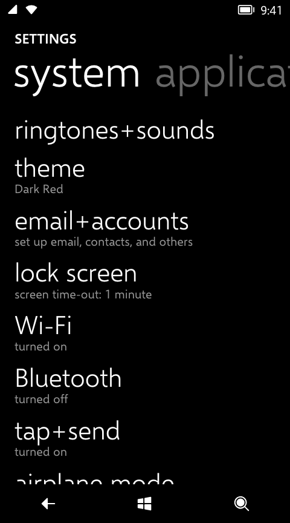
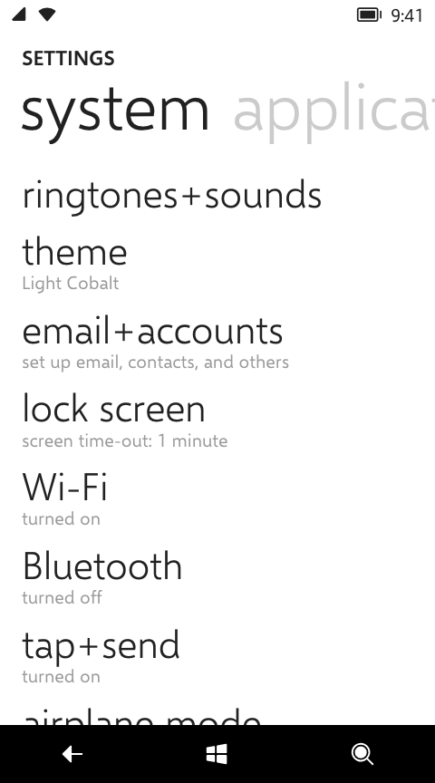
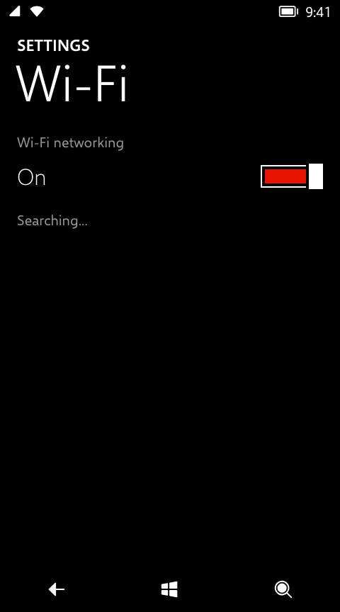
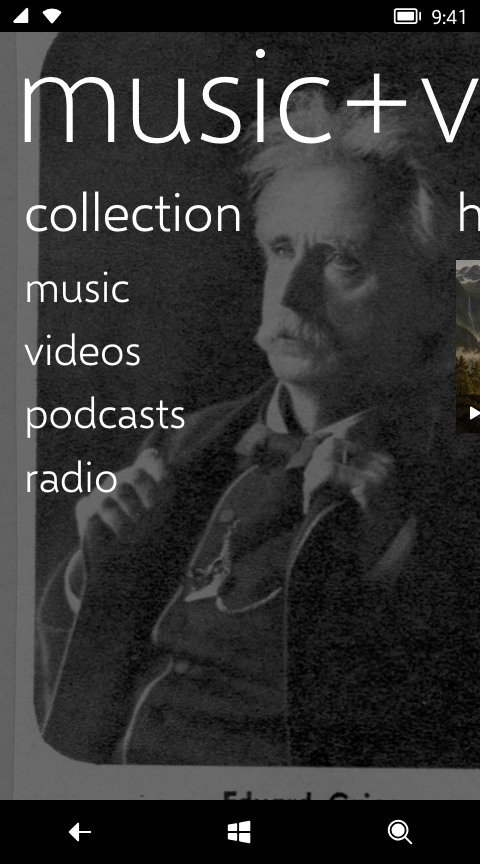
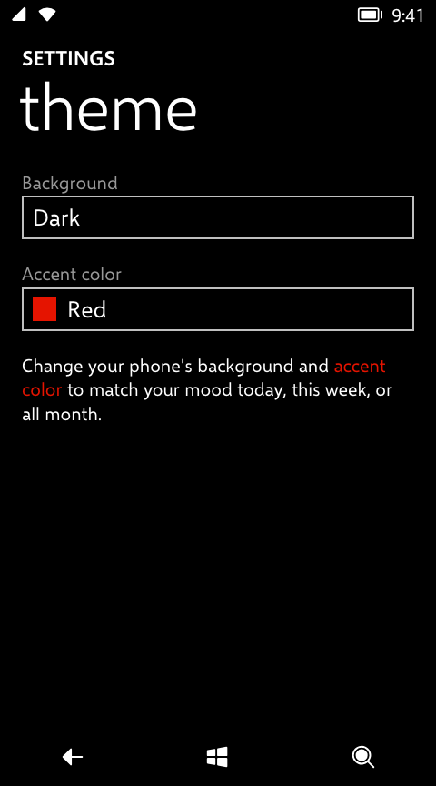
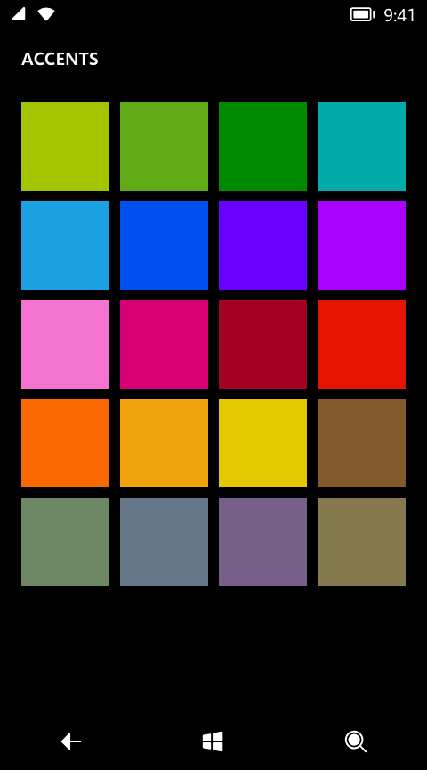
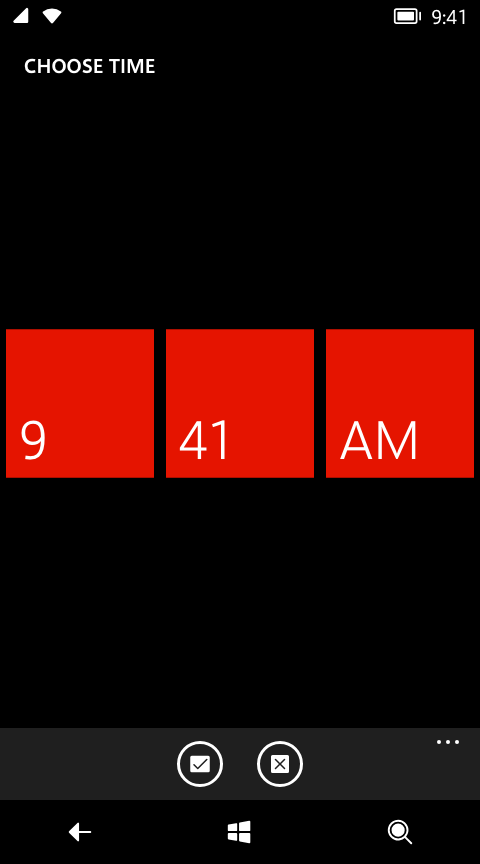
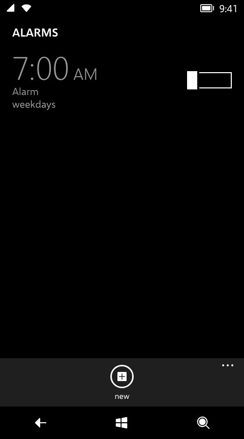
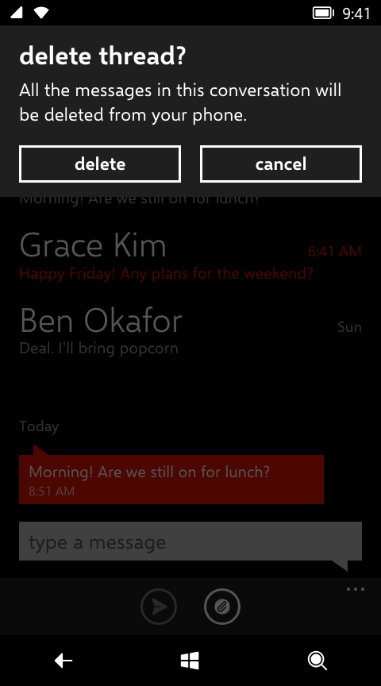

# 09 · Components

> **Status** Draft · **Baseline** 8.0 · **Last reviewed** 2026-10-19
> **Code** [`src/components/`](../../src/components), [`src/index.css`](../../src/index.css), [`src/components/panorama.css`](../../src/components/panorama.css)
> **Sources** UIXMobile controls as used by `SettingsUI.exe`; Windows Phone Toolkit controls; `ThemeResources.xaml`; emulator screenshots

The shared building blocks. Each entry gives what it is, its metrics and states, how it behaves, and where it lives. Layout values not repeated here are in [Layout](03-layout.md); motion values are in [Motion](07-motion.md).

| Component | Code | Phone equivalent |
|---|---|---|
| [Pivot](#pivot) | `Pivot.tsx` | UIX `Pivot` |
| [Single-page pivot](#single-page-pivot) | `controls.tsx` `SettingsPage` | UIX `SinglePivotPage` |
| [Panorama](#panorama) | `Panorama.tsx`, `panorama.css` | UIX `Panorama` |
| [List item](#list-item) | `controls.tsx` `ListItem` | UIX `DoubleLineListItem` / `SingleLineListItem` |
| [Paragraph](#paragraph) | `controls.tsx` `Paragraph` | `PhoneTextNormalStyle` text block |
| [Button](#button) | `controls.tsx` `Button` | `PhoneButtonBase` |
| [Toggle switch](#toggle-switch) | `ToggleSwitch.tsx` | Toolkit `ToggleSwitch` |
| [List picker](#list-picker) | `ListPicker.tsx`, `AccentPicker.tsx` | Toolkit `ListPicker` (inline and full mode) |
| [Date and time pickers](#date-and-time-pickers) | `DateTimePicker.tsx`, `LoopingSelector.tsx` | Toolkit `DatePicker`, `TimePicker`, `LoopingSelector` |
| [Full-screen popup](#full-screen-popup) | `popup.tsx`, `popupLayer.ts` | Toolkit full-mode picker page |
| [App bar](#app-bar) | `AppBar.tsx`, `glyphs.tsx` | Shell `ApplicationBar` |
| [Message box](#message-box) | `MessageBox.tsx` | Shell `MessageBox` |
| [Text box](#text-box) | per app (see below) | `PhoneTextBox` |

## Pivot

A set of pages under one title, switched by swiping or tapping the headers. The headers form an endless strip: the selected header sits at the left, the rest follow, and they wrap.

 

<!-- demo: pivot -->

| Part | Value | Source |
|---|---|---|
| Title | SemiBold 22.667, uppercase, 17 px from the top, 24 px in | Decoded size (`PivotTitleFontSize`); position Estimated |
| Headers | SemiLight 72, line height 1.2, 21 px left padding | Decoded size (`PivotHeaderFontSize`); padding Estimated |
| Unselected headers | `--wp-pivot-unselected-opacity` (0.4 dark, 0.23144 light) | Decoded |
| Items | 28 px below the headers, 12 px side margins, scroll vertically | Decoded (`PivotItemMargin`) |

Behaviour:

- Swipe: the gesture locks to horizontal after 14 px; it commits past 25% of the width or at a flick of 0.45 px/ms, then snaps in 300 ms. Headers slide by the width of the header they're passing.
- Tapping the next header animates forward to it. Tapping any other header jumps straight there.
- Incoming rows cascade: each row after the first starts 32 px further along.
- Items that aren't selected stay mounted but are `inert` and `aria-hidden`, so each keeps its scroll position.
- The headers are a `tablist` labelled by the title; each item's header is its `tab` and the item its `tabpanel`. The copies of headers at either end of the strip are `aria-hidden`. Only the selected tab is in the tab order; the left and right arrows move one item, animating as a swipe does, and focus follows.
- The title and header strip are `data-feather`; the title is the page's `data-continuum-target`.

## Single-page pivot

`SettingsPage` is a Settings sub-page: the same title and header layout as the pivot, with one item and no swiping. The header is the page's `data-continuum-target`. The title defaults to `settings`, which CSS shows in capitals.

## Panorama

A hub: one wide canvas wider than the screen, with a big title and an optional background picture that both move slower than the content. Swiping past the last section wraps to the first.

<!-- demo: panorama -->

| Part | Value | Source |
|---|---|---|
| Section | 432 px wide (the next header peeks in 48 px), 146 px from the top, 12 px left padding | Estimated |
| Title | Light 133.333, 14 px in, 22 px above the top of the page area | Estimated |
| Section header | SemiLight 53.333, 12 px in, 18 px above the content | Estimated; `PanoramaItemHeaderFontSize` says 66 (see [open questions](14-evidence.md#open-questions)) |
| Background | 640 px wide (480 + 160 of travel), dimmed by the background colour at 55% | Estimated |
| Parallax | Title travels half its width across all sections; background travels 160 px | Estimated |

Behaviour:

- Locks after 14 px; commits past 20% of a section or at 0.45 px/ms; snaps in 450 ms.
- A touch during the snap catches the panorama where it is.
- When wrapping from the last section to the first, the title and background glide back rather than jump.
- Opens with the [hub intro](07-motion.md#hub-intro).
- Only the selected section is focusable; the others are `inert`. Its header is in the tab order, and the left and right arrows anywhere in the panorama move one section and focus the new header (`aria-keyshortcuts` says so). Arrows inside text boxes, sliders, spin buttons, list boxes and tabs are left alone.

## List item

The workhorse of Settings and most apps: a big title and an optional subtitle.

| Part | Value | Source |
|---|---|---|
| Title | SemiLight 42.667, line height 1.2 | Decoded (`PhoneTextExtraLargeStyle`) |
| Subtitle | Normal 20, subtle, 3 px tighter to the title | Decoded colour and size; spacing Estimated |
| Padding | 0 12 px; 12 px below each item | Decoded (`PhoneTouchTargetOverhang`) |

The whole item is one `button` with tilt and `data-feather`. A tap navigates; the item doesn't show a selected state.

## Paragraph

Body text: Normal 20, 12 px side margins, 24 px below. `subtle` uses `--wp-subtle`. Each paragraph is `data-feather`, so it turns with the rows.

## Button

| State | Look |
|---|---|
| Rest | 3 px foreground border, SemiBold 22.667, padding 5 10 6, 12 px margin |
| Pressed | Accent fill and border, white text, plus tilt |

Border thickness is Decoded (`PhoneBorderThickness`); the rest is Estimated.

## Toggle switch

A header, the current state in words, and the switch.

<!-- demo: toggle-switch -->

| Part | Value | Source |
|---|---|---|
| Header | Normal 20, subtle | Estimated |
| Row | 72 px tall; the state label (Light 32, "On" / "Off") on the left, the switch on the right | Estimated |
| Track | 88 × 32, 2 px foreground border | Estimated |
| Fill | Accent, 20 px tall, 4 px inside the border, grows with the thumb | Estimated |
| Thumb | 20 × 36 foreground bar, with 4 px gaps in the background colour on each side | Estimated |
| Motion | 500 ms `EXPO_OUT_15` | Toolkit |

- Tap anywhere on the row to toggle. Drag the thumb (after 6 px) and release past halfway to toggle.
- Disabled: header, label, border, thumb and fill all use `--wp-disabled`.
- `role="switch"` with `aria-checked`; labelled by the header.

## List picker

Shows the current choice in a box. Tapping it opens the options inline, or (in full mode) a full-screen list.

<!-- demo: list-picker -->

| Part | Value | Source |
|---|---|---|
| Header | Normal 20, subtle, 2 px above the box | Estimated |
| Box | 2 px border in `--wp-text-box`, 12 px side margins | Decoded colour; size Estimated |
| Rows | 44 px, MediumLarge 25.333, 10 px padding; optional 26 px colour swatch | Estimated |
| Open | Edit background, accent border, text box foreground; selected row in accent | Decoded colours |
| Opening | Grows from one row to all rows over 250 ms | Estimated |

- Back closes an open picker without changing the value.
- `onOpenFullMode` replaces inline opening. The accent picker uses it: a swatch grid (4 columns, 12 px gaps) under an accents header (shown in capitals), swivelling in over the page. The current swatch takes focus.

## Date and time pickers

A field shows the value; tapping it opens a full-screen page of spinning columns with **done** and **cancel** in the app bar.

<!-- demo: time-picker -->

| Part | Value | Source |
|---|---|---|
| Field | 48 px tall, `--wp-text-box` fill, text box foreground, MediumLarge; pressed: accent fill, white text | Estimated |
| Page title | CHOOSE TIME / CHOOSE DATE (written lower case, upper-cased by CSS), SemiBold 20, 20 px from the top, 24 px in | Estimated |
| Columns | 148 px wide, centred, 12 px apart | Estimated |
| Items | 148 × 148 squares on a 160 px step, 3 px subtle border; primary SemiLight 54, secondary Normal 20 | Estimated |
| Selected item | Accent fill and border, white text | Estimated |

- At rest only the selected item in each column shows. Touching a column reveals its neighbours (200 ms fade) so it can be spun.
- Drag or flick to spin; it settles on the nearest item in 320 ms. Tapping a neighbour in an open column spins to it.
- Hours and minutes loop; AM/PM and years don't. Days follow the chosen month.
- Arrow keys and the mouse wheel step a column. Each column is a `spinbutton`.
- Date fields show `M/D/YYYY`; time fields show `h:mm AM`.

## Full-screen popup

`FullScreenPopup` renders a page in the popup layer that swivels in over the current page, closes on Back (swivelling out), and gives its content `usePopupClose()`. Pickers and other full-screen choosers use it. It is a `dialog` with a label and `aria-modal`, and takes focus itself on open, so a picker opens with every column closed, as on the phone; Tab then moves into the columns or the list.

## App bar

Up to four round icon buttons and an ellipsis at the bottom of a page, with an optional menu. Tapping the ellipsis or any empty part of the bar slides it up to show the button labels and the menu.

<!-- demo: app-bar -->

| Part | Value | Source |
|---|---|---|
| Bar | `--wp-chrome`; 72 px collapsed, 30 px minimized; grows upward over the content | Estimated |
| Buttons | 80 px slots, centred, 12 px top and bottom padding; 48 px ring, 3 px stroke, 24 px glyph | Estimated; stroke Decoded |
| Labels | Normal 16, lowercase, 4 px below the ring, only when expanded | Estimated |
| Ellipsis | 64 × 36 target in the top right; three 4 px dots 5 px apart | Estimated |
| Menu | Items 9 × 24 px padding, Normal 25.333, lowercase; pressed in accent | Estimated |

- Expands in 250 ms, collapses in 200 ms. A tap outside, Back, or choosing an item collapses it.
- A pressed button fills its ring with the foreground and draws the glyph in the chrome colour. Disabled buttons are at 0.4 opacity; disabled menu items use `--wp-disabled`.
- Minimized bars show only the ellipsis until expanded.
- Buttons have `aria-label`s; the ellipsis reports `aria-expanded`; the menu is a `menu` of `menuitem`s.
- Pass a name from `glyphs.tsx`, or an SVG fragment on the same 48-unit grid.

## Message box

A chrome-coloured panel that drops down from the top of the page over a dimmed scrim, with a caption, an optional message and one or two buttons. Back dismisses it as if the last button had been pressed, without running its action.

<!-- demo: message-box -->

`MessageBox` takes a `caption`, an optional `message`, up to two `buttons` (`{ label, onTap }`) and `onDismissed`. When a button is tapped the box closes, then `onDismissed` runs, then the button's `onTap`; so an action that presses Back (delete, then leave the page) reaches the page.

| Part | Value | Source |
|---|---|---|
| Scrim | `--wp-semitransparent` | Decoded colour |
| Panel | `--wp-chrome`, padding 18 12 6 | Estimated |
| Caption | SemiBold 32, 12 px in | Estimated |
| Message | Normal 22.667 | Estimated |
| Buttons | Two equal columns, styled like [Button](#button) | Estimated |
| Motion | Swivel in and out from the top edge; scrim fades in 200 ms, out 250 ms | Estimated |

It is an `alertdialog` with `aria-modal`, labelled by the caption and described by the message. `useModal` moves focus to the first button, makes the app behind `inert`, and gives focus back on close. The buttons tilt.

Every app's message box is this component. Don't copy it into an app.

## Text box

`PhoneTextBox`: a filled box at rest that turns into the edit background with an accent border while focused.

| State | Fill | Border | Text |
|---|---|---|---|
| Rest | `--wp-text-box` | 3 px transparent | `--wp-text-box-foreground` |
| Focused | `--wp-text-box-edit-background` | 3 px accent | `--wp-text-box-foreground` |

Colours and border thickness are **Decoded**; size and padding are **Estimated** (MediumLarge text, 0 9 px padding).

**There is no shared component yet.** Copies live in `people.css` (`.people-textbox`, 50 px, accent caret), `alarms.css` (48 px, text-coloured caret), `calendar.css` (48 px, plus a multiline variant), `messaging.css` (auto height, 5 9 px padding, a speech-bubble tail) and `onenote.css` (52 px). Heights vary between 48, 50 and 52 px, and the caret colour varies. `PhoneTextCaretColor` says the caret should match the text box foreground. Consolidate before adding another.
