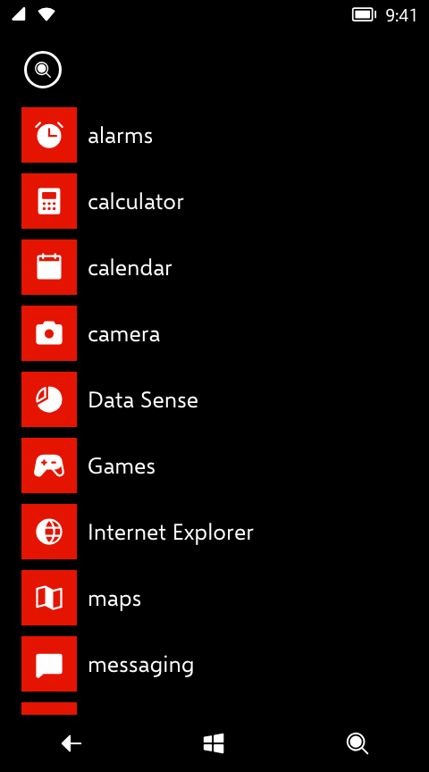
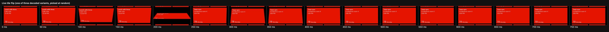

# 10 · Start and live tiles

> **Status** Draft · **Baseline** 8.0 · **Last reviewed** 2026-10-19
> **Code** [`src/start/StartScreen.tsx`](../../src/start/StartScreen.tsx), [`src/start/Tile.tsx`](../../src/start/Tile.tsx), [`src/start/apps.ts`](../../src/start/apps.ts), [`src/start/tileFlip.ts`](../../src/start/tileFlip.ts), [`src/start/icons.tsx`](../../src/start/icons.tsx)
> **Sources** App manifests in `Windows\System32\Manifests` (tile templates); `ShellControls.dll` UIX markup (flip animations, decoded by [`anims.py`](../evidence/uix/tools/anims.py) into `anims_shell.txt`, kept private); 8.1 footage (feather timing)

Start is the home screen: a scrolling grid of tiles in the accent colour, with the app list one swipe to the right. Tiles are live: they flip, cycle and update on their own.

 

## Panes

Start is a 960 px strip of two 480 px panes that scroll vertically.

| Pane | Contents |
|---|---|
| Tiles | The tile grid, then a 48 px arrow button (44 px ring) at the bottom right that opens the app list |
| App list | A 48 px search button (not wired up yet), then every app sorted by display name, ignoring case |

- Swipe horizontally (locks after 14 px) to switch panes. It commits past 120 px or at a flick of 0.45 px/ms and settles in 350 ms. Past either end the strip follows at a third of the finger's speed.
- The pane that isn't showing is `inert`.
- Live tiles only run while the tiles pane is showing and no app is open.

## Tile grid

Measurements are in [Layout](03-layout.md#start). In short: four 99 px columns, 12 px gaps, 24 px side padding, packed densely in row order.

| Size | Cells | px | Title | Glyph |
|---|---|---|---|---|
| Small | 1 × 1 | 99 × 99 | none | 44 px |
| Medium | 2 × 2 | 210 × 210 | Normal 18.667, 12 px in, 6 px up | 84 px |
| Wide | 4 × 2 | 432 × 210 | as medium | 84 px |

Tiles are always the accent colour with white content, in both themes. A count sits to the right of the glyph (Normal 53.333, or 26.667 on small tiles).

The image has no default Start layout (the phone writes one on first boot), so `DEFAULT_LAYOUT` in `apps.ts` is composed by hand.

## Templates

Each app's tile template comes from the `PrimaryToken` in its manifest (**Decoded**). The recreation implements these:

| Manifest template | `live.kind` | Apps | What it does | Timing |
|---|---|---|---|---|
| `TemplateMetroCount` | `iconic` | phone, messaging, Outlook, Store, camera, maps, calculator, settings, Internet Explorer, Games | Glyph and an optional count | — |
| `TemplateFlip` | `flip` | OneNote, Office, Wallet, Data Sense | Flips between the front and a back with a title and lines of text | Every 6–10 s |
| `TemplateFlip` | `alarm` | alarms | Flips to the next alarm's time and day while one is on | Every 6–10 s |
| `TemplatePeople` | `people` | people | A grid of contact pictures (3 × 3 medium, 6 × 3 wide); single cells flip to other contacts | A cell every 2.2–4.2 s |
| `TemplateCycle` | `cycle` | photos | Pictures pan up into the tile one after another (camera roll, then sample pictures) | Every 5–7 s |
| `TemplateCalendar` | `calendar` | calendar | The next appointments in the coming week; today's day number and name where the title would be | Flips to the next appointment every 8–11 s |
| `TemplateMusicVideo` | `music` | Music+Videos | The album last played (or, on a wide tile, its artist's picture) | — |

Intervals are **Estimated**. Each tile picks a random delay in its range (the shell's `GetRandomAnimationDelay`, a **Decoded** name), so tiles never move in step.

Counts: messaging shows unread threads and phone shows missed calls, both from app data; Outlook (5) and Store (3) are fixed.

A tile's accessible name is its title plus what it says: its count ("phone, 1 missed"; "messaging, 2 new"), Calendar's next appointment, or the next alarm. The wording is the project's own (**Estimated**). Tests and scripts find tiles by `data-app`, which doesn't change.

Not implemented: `TemplateGames`, `TemplateGroup` and `TemplateDeepLink`, and tile notifications that interrupt a flip (`Template1112_FlipNotificationInterruptDuration`).

### Rules for live tiles

- Live behaviour runs only while Start's tiles are visible.
- Small tiles never animate; they show their glyph (or, for calendar, the day number).
- Nothing animates under reduced motion.
- Flip tiles turn over as a whole, background and all.

## Flip motion

Decoded from `FlipTile.uix` and `FlipGrid.uix` in `ShellControls.dll`. Each flip is two tracks that play together: the outgoing face's (hide) and the incoming face's (show). At the **swap** time the outgoing face disappears and the incoming one appears, both edge-on, so one element can play the hide track up to the swap and the show track after it.

### Tile flips

The shell picks one of three variants at random for each flip. The markup times are halved by the `TimeScale 0.5` that wraps the tile flips; the times below are after halving. Tiles turn about their horizontal axis (`rotateX`) with `perspective(800px)` (Estimated).

| Variant | Hide track | Show track | Swap |
|---|---|---|---|
| 1 | 0° → 90° by 250 ms (Exp, weight 10) | −90°, held to 250 ms → 0° by 750 ms (Log, 150) | 250 ms |
| 2 | 0° → 215° by 183 ms (Log, 10) | −180° → 35° by 183 ms (Log, 10) → −6° by 417 ms (SCurve, 10) → 0° by 625 ms (SCurve, 10) | 40 ms |
| 3 | 0° → −30° by 125 ms (SCurve, 10) → 200° by 292 ms (SCurve, 10) | −210°, held to 125 ms → 20° by 292 ms (SCurve, 10) → 0° by 458 ms (SCurve, 10) | 209 ms |

All keyframes are **Decoded**.

### People cell flips

Cells use `NormalizedCellFlip*` (TimeScale 1), on a timeline normalized to 0–1. The recreation plays it over 1000 ms; the real duration comes from `FlipCellDurationMin` / `Max`, which aren't decoded (Estimated).

| Track | Keyframes | Swap |
|---|---|---|
| Hide | 0° → 90° by 0.137 (Log, 1.99) | 0.12 |
| Show | −180° → 0° by 1.0 (Log, 150) | |

Horizontal cells turn about the X axis; vertical ones play the same motion about Y. Half the flips pick each, at random, with `perspective(300px)` (Estimated).

### Curves

Iris (the phone's animation engine) interpolations as `uixrender` computes them, with weight `w`:

- **Exp** eases in: `(wᵗ − 1) / (w − 1)`.
- **Log** eases out: the mirror of Exp.
- **SCurve**: its exact shape wasn't decoded. The recreation uses Exp mirrored about the midpoint (Estimated).

They have no CSS equivalent, so `tileFlip.ts` samples each track into keyframes every 8 ms.

### Cycle

The cycle tile pans a two-picture strip up by one tile height in 1200 ms (`cubic-bezier(0.45, 0, 0.2, 1)`), then swaps in the next picture. Estimated.

## Tile content details

| Tile | Detail | Source |
|---|---|---|
| Flip back | Lines of Normal 20 (line height 1.3) 8 px from the top, 12 px in; the back's title replaces the app name | Estimated |
| Calendar | First line (the event title) SemiBold; title row: day number (32 px) and weekday; lines show title, location and when ("all day", "9:00 AM", "Tue 9:00 AM") | Estimated |
| Calendar, small | The day number, Normal 42.667, centred | Estimated |
| People | Contacts have no photos, so each cell is the contact's initials (SemiLight 26.667) on one of four shades of the accent | Estimated (a [deviation](13-web-and-accessibility.md#rendering)) |
| Music | Album or artist art fills the tile; the title gets a soft shadow | Estimated |

## Not implemented

- Pinning, unpinning, resizing and moving tiles (press and hold).
- Wide tiles for every app; the tile sizes in `DEFAULT_LAYOUT` are fixed.
- 8.1's six-column layout, transparent tiles and Start background.
- Letter groups and the jump list in the app list.
- The lock screen.

## Open questions

- `TileTemplate*` sizes and margins (`TileTemplateFlipMessageMargins`, `TileTemplateFlipNotificationFontSize`, …) are named in the markup but their values aren't decoded.
- `VerticalCellFlipShow` is wrapped in a `TimeScale 0.5` in the markup; the recreation doesn't apply it.
- `FlipCellDurationMin` / `Max` (and their 3 × 3 variants) are undecoded.

See [Evidence](14-evidence.md#open-questions).
