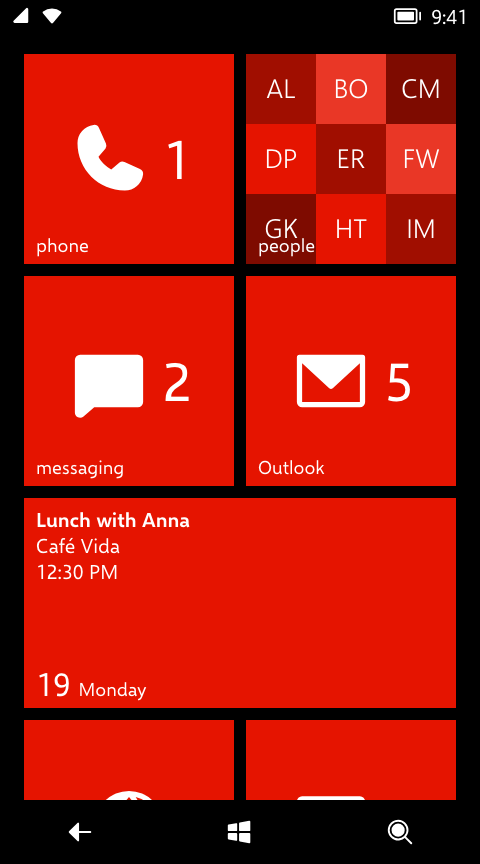
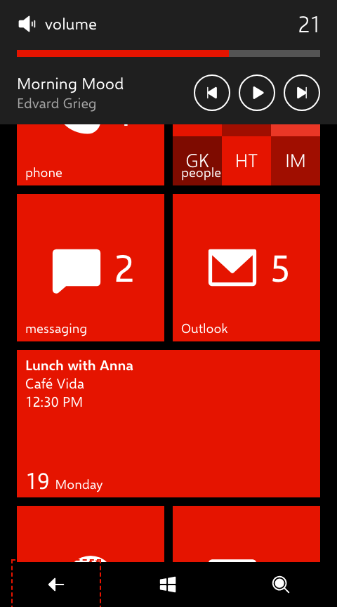

# 11 · System UI

> **Status** Draft · **Baseline** 8.0 tray and volume band, 8.1 navigation bar · **Last reviewed** 2026-10-19
> **Code** [`src/App.tsx`](../../src/App.tsx) (`SystemTray`, `NavBar`, safe areas), [`src/VolumeBand.tsx`](../../src/VolumeBand.tsx), [`src/MotionSpeedControl.tsx`](../../src/MotionSpeedControl.tsx), [`src/apps/alarms/AlarmRinger.tsx`](../../src/apps/alarms/AlarmRinger.tsx), [`src/index.css`](../../src/index.css)
> **Sources** Emulator screenshots; 8.1 footage (navigation bar)

The parts of the screen the system owns. Apps never draw here.

## System tray

A 32 px strip across the top of the screen, transparent over the page background, in the foreground colour.

| Part | Value | Source |
|---|---|---|
| Height and padding | 32 px; 12 px each side | Estimated |
| Left | Signal (or airplane mode) 20 px; Wi-Fi 20 px when on; Bluetooth 18 px when on; 10 px apart | Estimated |
| Right | Battery 28 px (a lower level while battery saver is on), then the time | Estimated |
| Time | Normal 20, 12-hour, no AM/PM, updated every 10 s | Estimated |

- Indicators follow the Settings state: airplane mode, Wi-Fi, Bluetooth, battery saver.
- Tapping the tray opens the [volume band](#volume-band). On the phone, tapping the tray reveals the hidden indicators instead (a [deviation](13-web-and-accessibility.md#input-and-navigation)).
- The tray is hidden from assistive technology.
- In a home-screen web app the device's own status bar is always visible, so the tray is left out and tapping the top safe area opens the volume band. See [Canvas](02-canvas.md#home-screen-web-apps).

## Navigation bar

The 8.1 on-screen navigation bar stands in for 8.0's hardware keys.

| Part | Value | Source |
|---|---|---|
| Bar | 64 px, black in both themes | Estimated, from 8.1 footage |
| Buttons | Back, Start, Search; 120 px wide, evenly spaced; 30 px white glyphs | Estimated |
| Pressed | 0.5 opacity | Estimated |

Back and Start follow the [navigation model](08-navigation.md#what-each-key-does). Search does nothing yet, and is `aria-disabled`. Each button has an `aria-label`; the bar is a `nav` labelled "Navigation bar".

## Volume band

The band the phone drops from the top of the screen when a volume key is pressed.

<!-- demo: volume-band -->

| Part | Value | Source |
|---|---|---|
| Band | `--wp-chrome`, padding 10 24 18, over everything including the tray | Estimated |
| Level row | 48 px: speaker glyph (crossed out at 0), "volume" (Normal 22.667), the level (SemiLight 32) | Estimated |
| Slider | 36 px target; a 10 px track in `--wp-subtle` at 0.4 opacity, filled with the accent | Estimated |
| Range | 0 to 30, one step per key press | Settled for 8.0 (one shared volume) |
| Media row | While music is queued: title (Normal 22.667) and artist (Normal 20, subtle), then previous, play/pause and next as 52 px circles with a 2 px border | Estimated |
| Motion | Drops in over 300 ms; slides out over 200 ms, 3 s after the last touch or key press | Estimated |

Opened by the desk's volume keys, the keyboard (**+**, **−**, media volume keys), or tapping the tray. Touching the band keeps it open. The slider is a `slider` from 0 to 30 and takes arrow keys. 8.1 split ringer and media volume; the recreation follows 8.0.

## Alarm ringer

`AlarmRinger` watches the alarms and, when one comes due, swivels a full-screen alarm in over whatever is running, with snooze and dismiss. Left alone it snoozes itself after 10 minutes. Alarms that came due while the tab slept still ring on wake if they are less than 30 minutes late.

## Desk controls

On viewports at least 1100 px wide, two panels sit on the "desk" beside the phone. They are recreation tools, not phone features, styled to match.

| Control | Where | What it does |
|---|---|---|
| Animation speed | Bottom left | A slider from 0.05× to 2× and presets (0.1×, 0.25×, 0.5×, 1×, 2×). See [the motion speed dial](07-motion.md#the-motion-speed-dial). |
| Volume keys | Bottom right | − and + buttons standing in for the hardware volume rocker |

Their text (13–15 px) is outside the phone's type ramp.

## Safe areas

On devices with notches or home indicators, black strips fill the top and bottom insets, and the bottom strip extends the navigation bar. See [Canvas](02-canvas.md#scaling-viewport-height-and-safe-areas).
